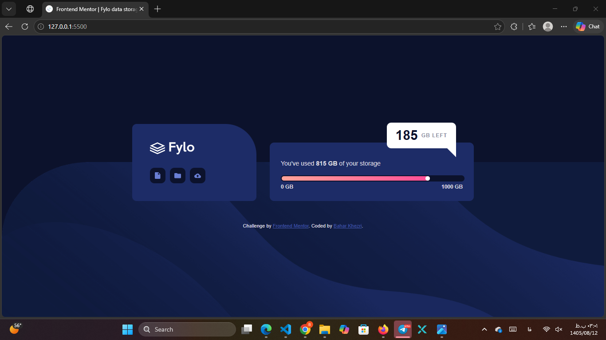

# Frontend Mentor - Fylo data storage component solution

This is a solution to the [Fylo data storage component challenge on Frontend Mentor](https://www.frontendmentor.io/challenges/fylo-data-storage-component-1dZPRbV5n).

## Table of contents

- [Overview](#overview)
- [My process](#my-process)
- [Author](#author)

## Overview

### The challenge

Users should be able to:
- View the optimal layout for the site depending on their device's screen size
- See hover states for all interactive elements on the page

### Screenshot

### Links

- Solution URL: [My Frontend Mentor Solution](https://www.frontendmentor.io/solutions/fylo-data-storage-component-ByBaharKhezri)
- Live Site URL: [Live Demo](https://baharkhezri.github.io/fylo-data-storage-component-master/)

## My process

### Built with

- Semantic HTML5 markup
- CSS custom properties
- Flexbox
- Mobile-first workflow

### What I learned

During this project, I faced some interesting challenges, especially with positioning and responsiveness. 

**1. Positioning (Absolute & Relative):**
I had a hard time creating the white tooltip (185 GB LEFT) and making its little triangle point correctly to the card. I learned how `position: relative` on the parent and `position: absolute` on the child work together to place elements exactly where I want them.

**2. Responsive Design:**
Making the layout work on mobile was tricky. I struggled to get the tooltip to move to the bottom of the card on smaller screens without breaking the layout. I also had to deal with some horizontal scroll issues. I learned how to use `@media` queries effectively and how to adjust `flex-direction` from row to column for mobile views.

### Continued development

In future projects, I want to get more comfortable with:
- Using CSS Grid for more complex layouts.
- Making animations smoother and more performant on mobile devices.
- Improving my debugging skills for responsive issues (like horizontal scrolling).

## Author

- Frontend Mentor - [@BaharKhezri](https://www.frontendmentor.io/profile/BaharKhezri)
- GitHub - [@BaharKhezri](https://github.com/BaharKhezri)
